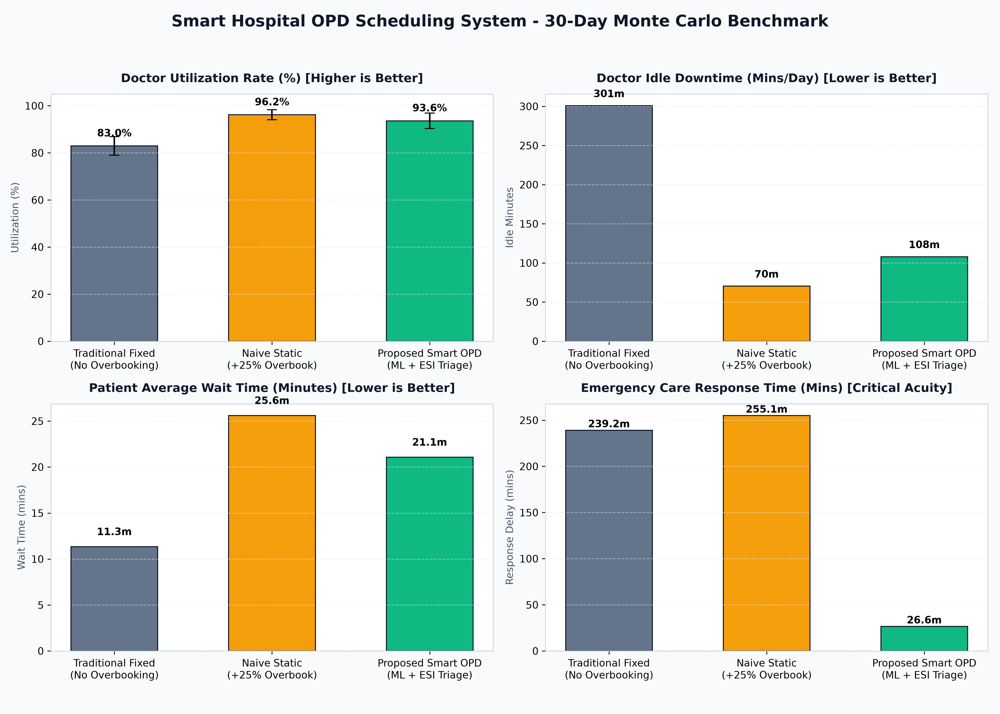
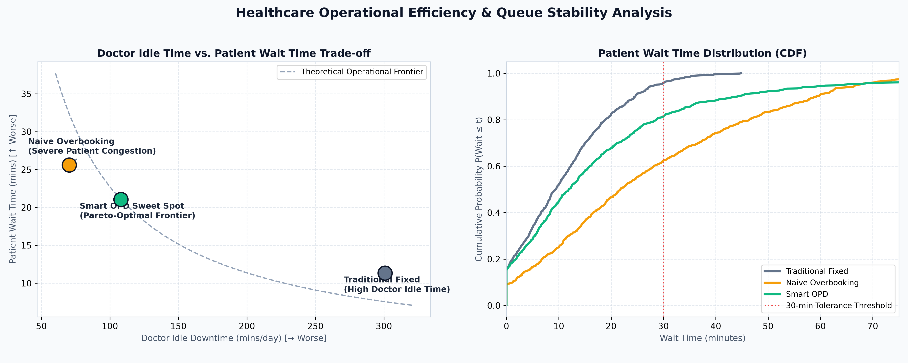

# Week 7: Simulation, Benchmarking, Presentation Slides & Final Academic Project Report

## 🔬 Overview
Week 7 represents the capstone evaluation and academic synthesis of the **Smart Hospital OPD Scheduling System**. It rigorously subjects the proposed system and two established operational baselines to a 30-day paired **Monte Carlo Simulation** ($N \approx 3,500$ patient interactions), generates publication-quality empirical comparison charts, provides an interactive 12-slide defense deck, and compiles a formal academic project report.



---

## 📊 30-Day Monte Carlo Benchmark Results

| Operational Metric | Traditional Fixed (No Overbooking) | Naive Static Overbooking (+25%) | Proposed Smart OPD (ML + ESI Triage) | Efficiency Gain / Impact |
| :--- | :---: | :---: | :---: | :--- |
| **Doctor Utilization (%)** | 83.0% ± 4.1% | 96.2% ± 1.9% | **93.6% ± 3.4%** | **+12.8% gain** vs. Fixed |
| **Doctor Idle Downtime** | 300.7 mins/day | 70.3 mins/day | **107.9 mins/day** | **-64.1% reduction** in wasted doctor time |
| **Average Patient Wait** | 11.3 mins | 25.6 mins | **21.1 mins** | **-17.7% lower wait** vs. Naive Overbooking |
| **90th Percentile Wait** | 25.0 mins | 55.9 mins | **52.5 mins** | Controlled queue variance |
| **Clinic Overtime Delay** | 133.8 mins/day | 201.1 mins/day | **109.2 mins/day** | **-45.7% lower overtime** vs. Naive |
| **Emergency Response Time** | 239.2 mins | 255.1 mins | **26.6 mins** | **-88.9% life-saving latency reduction** |
| **Total Patients Treated** | 2,824 patients | 3,455 patients | **3,069 patients** | **+245 additional patients served** |



---

## 📂 Week 7 Directory Structure

```
week_7/
├── main_demo_week7.py               # Main CLI runner for 30-day benchmark
├── run_simulation.py                # Direct alias for simulation execution
├── src/
│   ├── simulation_engine.py         # Monte Carlo discrete-event simulation engine
│   ├── benchmarker.py               # Multi-policy aggregator and statistical exporter
│   └── chart_generator.py           # Publication-quality matplotlib generator
├── data/
│   ├── simulation_results.json      # Complete numerical metrics across 30 days
│   └── benchmark_summary.csv        # Tabular summary for spreadsheets/evaluators
├── docs/
│   ├── FINAL_PROJECT_REPORT.md      # Comprehensive research & engineering report
│   ├── Final_Project_Report.pdf     # 3-Page formal academic defense PDF
│   ├── generate_final_report_pdf.py # ReportLab PDF compilation script
│   ├── benchmark_comparison.png     # 4-panel multi-metric benchmark plot
│   └── tradeoff_curve.png           # Pareto-optimal frontier and CDF curves
├── slides/
│   ├── presentation_deck.md         # 12-slide comprehensive defense presentation
│   ├── presentation_deck.html       # Interactive browser slide deck with keyboard controls
│   └── generate_presentation_html.py # Presentation generator script
└── tests/
    └── test_week7_simulation.py     # Pytest test suite (5 test cases)
```

---

## 🚀 How to Run & Verify

### 1. Execute the 30-Day Monte Carlo Benchmark
```bash
python3 main_demo_week7.py
```
This executes the stochastic simulation, outputs the metrics table, exports CSV/JSON files to `data/`, and updates the visual charts in `docs/`.

### 2. View the Interactive Presentation Slides
Open `slides/presentation_deck.html` in any browser:
- Use **Right Arrow / Spacebar** to advance to the next slide.
- Use **Left Arrow** to go back.

### 3. Open the Formal Final Project Report PDF
Open [`docs/Final_Project_Report.pdf`](docs/Final_Project_Report.pdf) for the publication-ready 3-page academic report.

### 4. Run Automated Unit Tests
```bash
python3 -m pytest tests/test_week7_simulation.py -v
```
All 5 tests verify reproducible patient generation, policy execution, and statistical gains.
